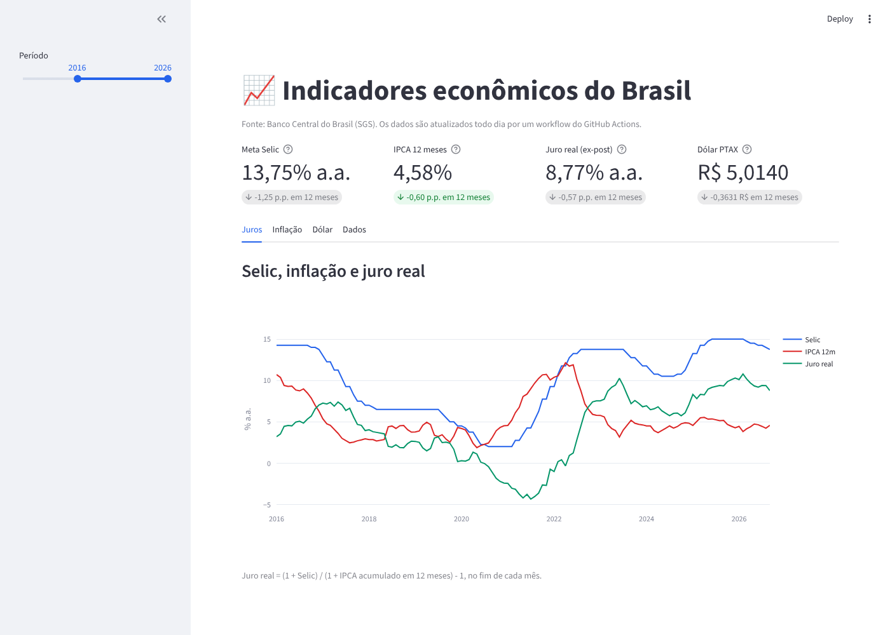

# Indicadores BR

[](https://github.com/FelipeYabiko/indicadores-br/actions/workflows/ci.yml)
[](https://github.com/FelipeYabiko/indicadores-br/actions/workflows/update-data.yml)


Pipeline de dados que coleta **Selic, IPCA, IGP-M e dólar** da API de dados abertos do **Banco Central**, guarda o
histórico desde 2010 em CSV e mostra tudo num **dashboard Streamlit**. Um workflow do **GitHub Actions** roda a coleta
todo dia útil e faz commit só do que mudou: o próprio repositório é o banco de dados.



## O que tem aqui

- **ETL incremental**: na primeira execução baixa o histórico inteiro; depois, só os últimos dias (com uma margem para
  pegar revisões).
- **Cliente HTTP resiliente**: divide períodos longos em janelas (a API limita séries diárias a 10 anos por consulta),
  repete erros temporários com backoff exponencial e trata "sem dados" como lista vazia.
- **Análise de séries temporais com pandas**: inflação acumulada em 12 meses (juros compostos), juro real pela equação
  de Fisher, variação do dólar e reamostragem diária → mensal.
- **Dashboard**: cards com a variação em 12 meses, gráficos interativos (Plotly), filtro de período e download dos
  dados em CSV.
- **Automação**: coleta agendada (cron) no GitHub Actions, com resumo da execução e commit automático.
- **Testes sem internet**: as respostas da API são simuladas com `httpx.MockTransport`.

## Séries

| Chave | Série | Código SGS | Unidade | Frequência |
| --- | --- | --- | --- | --- |
| `selic` | Meta Selic | 432 | % a.a. | diária |
| `ipca` | IPCA | 433 | % no mês | mensal |
| `igpm` | IGP-M | 189 | % no mês | mensal |
| `dolar` | Dólar PTAX (venda) | 1 | R$/US$ | diária |

Para incluir outra série, adicione uma linha em [`series.py`](src/indicadores/series.py) com o código do
[SGS](https://www3.bcb.gov.br/sgspub/).

## Como rodar

Requer Python 3.11+.

```bash
git clone https://github.com/FelipeYabiko/indicadores-br.git
cd indicadores-br
python -m venv .venv && source .venv/bin/activate
pip install -e ".[dashboard,dev]"

indicadores atualizar          # baixa dados novos (ou: indicadores atualizar ipca dolar)
indicadores resumo             # valor mais recente de cada série
streamlit run app.py           # abre o dashboard em http://localhost:8501
```

```text
$ indicadores atualizar
selic  desde 2026-09-06:    46 recebidas,    0 novas
ipca   desde 2026-07-18:     3 recebidas,    0 novas
igpm   desde 2026-07-18:     3 recebidas,    0 novas
dolar  desde 2026-09-05:    30 recebidas,    0 novas
```

### Publicar o dashboard

1. Entre em [share.streamlit.io](https://share.streamlit.io) com sua conta do GitHub.
2. Clique em **Create app**, escolha este repositório, a branch `main` e o arquivo `app.py`.
3. O app usa o `requirements.txt` e lê os CSVs de `data/`, que o workflow mantém atualizados.

## Testes

```bash
pytest
ruff check . && ruff format --check .
```

## Estrutura

```text
src/indicadores/
├── series.py      # catálogo das séries (código SGS, unidade, frequência)
├── bcb.py         # cliente da API: janelas, retries e parsing
├── storage.py     # CSV por série com upsert
├── pipeline.py    # ETL incremental
├── analysis.py    # acumulado 12m, juro real, variações
└── cli.py         # comandos `atualizar` e `resumo`
app.py             # dashboard Streamlit
data/              # CSVs atualizados pelo GitHub Actions
.github/workflows/
├── ci.yml          # lint e testes
└── update-data.yml # coleta agendada
```

Quer entender cada conceito em detalhe? Veja o [guia de estudo](docs/GUIA-DE-ESTUDO.md).

## Fonte dos dados

[Banco Central do Brasil, Sistema Gerenciador de Séries Temporais (SGS)](https://dadosabertos.bcb.gov.br/). Este
projeto não tem vínculo com o Banco Central.

## Licença

MIT
